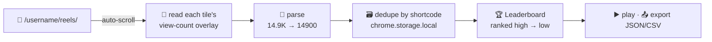

<div align="center">

# 🔎 Reels Sniffer

### Rank any Instagram profile's reels by view count — right in your browser.

Scroll a profile's **Reels** tab once. Reels Sniffer reads the view count off every
tile as it loads, dedupes them, and builds a **per-user leaderboard** sorted from
most-viewed to least — stored 100% locally, no account, no API keys, no server.

<br>


</div>

---

## ✨ Why it's nice

- **One click, whole catalog.** Auto-scrolls the Reels tab to the bottom and captures every reel on the way down.
- **A real leaderboard.** Reels ranked high→low with 🥇🥈🥉 medals for the top three, live view badges, and a built-in 9:16 player you can arrow-key through.
- **Speaks human _and_ Instagram numbers.** `9,045`, `14.9K`, `1M`, `2.2M` — parsed back to exact integers, including Spanish locale (`10,1 mil`, `1,2 M`).
- **Multi-profile memory.** Every profile you scan becomes a card on the home screen; re-scanning merges and keeps the highest figure seen per reel.
- **Yours, and only yours.** All data lives in `chrome.storage.local`. Nothing leaves your machine. Export to JSON/CSV whenever you want.
- **No build step.** Plain HTML/CSS/JS. Clone, load unpacked, done.

---

## 🎬 How it works



Instagram renders each reel's views as a small overlay (`9,045`, `14.9K`, …) on top of
the thumbnail. Reels Sniffer's content script walks each `/reel/…` tile, finds that
leaf of text, and converts it back into a precise number using the rules below.

### The number grammar it understands

| On screen        | Meaning              | Stored as   |
| ---------------- | -------------------- | ----------- |
| `9,045`          | exact (under 10K)    | `9045`      |
| `14.9K` / `234K` | thousands            | `14900`     |
| `1M` / `2.2M`    | millions             | `2200000`   |
| `1.4B`           | billions             | `1400000000`|
| `10,1 mil` 🇪🇸    | thousands (ES)       | `10100`     |
| `1,2 M` 🇪🇸       | millions (ES)        | `1200000`   |

> Under 10K Instagram shows the exact figure; at and above it, an abbreviated one.
> The parser handles both, plus English/Spanish decimal and thousands separators.

---

## 🚀 Install

Reels Sniffer isn't on the Web Store — you load it unpacked (takes ~20 seconds):

1. **Clone / download** this repo.
2. Open **`chrome://extensions`** in Chrome (or any Chromium browser).
3. Toggle **Developer mode** on (top-right).
4. Click **Load unpacked** and select the **`extension/`** folder.

That's it — the 🔎 icon appears in your toolbar.

---

## 📖 Usage

1. Go to any profile's reels tab: **`instagram.com/{username}/reels/`**
2. A purple **🔎 Reels Sniffer** panel appears in the top-right. Hit **▶ Auto-scroll & sniff**.
   It scrolls to the bottom, reading view counts as tiles load, and stops automatically
   when the tab is exhausted. Live counters show reels found and the current top view.
3. Click **🏆 Open leaderboard** (or the toolbar icon) to browse:
   - **Users overview** — one card per profile you've scanned (reel count, top views, total, date).
   - **Leaderboard** — that profile's reels ranked by views, with medals, a 9:16 embed
     player (← → / scroll to navigate), shortcode search, sort modes, and **Export JSON / CSV**.

<div align="center">

**panel** ➜ scroll & capture &nbsp;•&nbsp; **leaderboard** ➜ rank, play, export

</div>

---

## 🔒 Privacy

Reels Sniffer is deliberately boring about your data:

- **No network calls.** It never phones home — there's no server to phone.
- **Only `storage` + `instagram.com`.** Those are the *entire* permission set (see `manifest.json`).
- **Everything is local** in `chrome.storage.local`, readable and deletable by you at any time.
- It only reads **publicly visible view counts** already on the page you're looking at.

---

## 🗂️ Project structure

```
extension/
├── manifest.json     # MV3 manifest — storage + instagram.com only
├── content.js        # the sniffer: scroll, read overlays, parse, dedupe, store
├── background.js     # service worker: opens/focuses the leaderboard tab
├── manager.html      # leaderboard UI (users overview + per-user ranking + player)
├── manager.js        # rendering, sorting, search, embed modal, export
└── icons/            # 16 / 48 / 128 px
```

### Data model (`chrome.storage.local` → `rs_data`)

```jsonc
{
  "username": {
    "username": "username",
    "scanned_at": "2026-08-26T…",
    "reels": {
      "SHORTCODE": {
        "shortcode": "SHORTCODE",
        "url": "https://www.instagram.com/reel/SHORTCODE/",
        "views": 14900,
        "image": "https://…",
        "captured_at": "2026-08-26T…"
      }
    }
  }
}
```

---

## ⚠️ Notes & limits

- Instagram's markup changes from time to time. If a scan reports reels captured but some
  show **"without a number"**, the view-overlay selector in `content.js` (`extractViews`) is
  the place to adjust — it already falls back from the tile anchor to the tile cell.
- Thumbnail URLs are Instagram CDN links and can expire; the leaderboard falls back to
  "click to play ▶", which always works via the reel's embed.
- This is an independent, unofficial tool. It is not affiliated with or endorsed by Instagram/Meta.
  Use it responsibly and within Instagram's Terms.

---

<div align="center">

**MIT Licensed** · Built with plain HTML/CSS/JS and zero dependencies.

</div>
